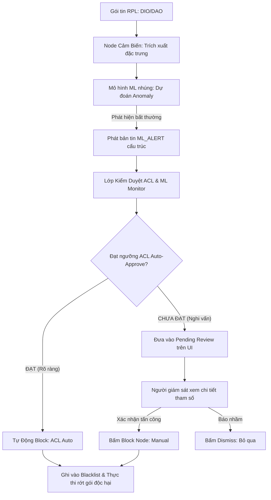

# Tóm Tắt Cách Hoạt Động: ML Nhúng Thiết Bị & Kiểm Duyệt Qua Lớp ACL

---

## 1. Sơ Đồ Luồng Hoạt Động (Flowchart)

---

## 2. Cách Nhúng Học Máy Vào Thiết Bị (Embedded ML)

1. **Trích xuất đặc trưng tại Node (Feature Extraction)**:
   - Khi nhận gói định tuyến (DIO/DAO), node tự tính toán 5 chỉ số mạng:
     - `dio_rate`: Tần suất gửi gói DIO (phát hiện Carousel / Flooding).
     - `version_delta`: Độ chênh lệch số phiên bản RPL.
     - `rank`: Cấp bậc định tuyến hiện tại.
     - `rank_delta`: Độ nhảy vọt cấp bậc (phát hiện Stretch / Rank Manipulation).
     - `is_poison`: Cờ định tuyến độc hại (Rank vô hạn).
2. **Suy luận trực tiếp (Lightweight Inference)**:
   - Mô hình cây quyết định (Decision Tree) được chuyển thể thành mã C tối ưu chạy trực tiếp trong vi điều khiển của node.
3. **Cơ chế Monitor Mode (Không tự block cục bộ)**:
   - **Trước đây**: Node tự block khi ML báo -> Dễ block nhầm diện rộng, cô lập node tốt.
   - **Hiện tại**: Node **chỉ phát hiện và phát bản tin `ML_ALERT`** (chứa ID node nghi vấn, loại tấn công, giá trị đặc trưng) gửi về trung tâm giám sát.

---

## 3. Quy Trình Kiểm Duyệt Qua Lớp ACL (2 Cấp Độ)

Bản tin `ML_ALERT` từ các node được đưa qua bộ kiểm duyệt **ACL Monitor** gồm 2 tầng:

### Tầng 1: ACL Tự Động Phê Duyệt (Auto-Approve Engine)
Giảm tải 80-90% áp lực cho người quan sát. Hệ thống **tự động duyệt Block ngay lập tức** nếu vi phạm một trong các ngưỡng cứng:
- **Cảnh báo liên tiếp**: `consecutive_alerts >= 3`
- **Tần suất DIO quá cao**: `dio_rate >= 40`
- **Nhảy vọt Rank bất thường**: `rank_delta >= 400`
- **Đổi phiên bản RPL lớn**: `version_delta >= 5`
- **Đồng thuận đa node**: Có từ $\ge 2$ node khác nhau cùng báo cáo 1 đối tượng.

### Tầng 2: Người Giám Sát Phê Duyệt Thủ Công (Human Supervisor)
Đối với các trường hợp chưa chạm ngưỡng cứng (nghi vấn, biên độ thấp):
- Cảnh báo nằm ở hàng đợi **Pending Alerts** trên Dashboard.
- Hiển thị đầy đủ: Địa chỉ node nghi vấn, loại tấn công, bảng chi tiết 5 tham số ML và danh sách các node phát hiện.
- **Quyền quyết định của giám sát viên**:
  - `Block Node`: Duyệt đưa vào danh sách chặn.
  - `Dismiss`: Hủy cảnh báo nếu xác định là báo nhầm (False Positive).

---

## 4. Thực Thi Chặn (Enforcement)

- Sau khi được duyệt (tự động hoặc thủ công):
  - Địa chỉ node độc hại được ghi vào **ACL Blacklist**.
  - Tầng mạng RPL tự động **loại bỏ (Drop) toàn bộ các gói tin** từ node bị chặn.
  - Sau thời gian khóa quy định (`block_duration`), hệ thống sẽ tự động gỡ để kiểm tra lại nếu cần.

---

## 5. Hỗ Trợ Quyết Định Cho Người Giám Sát (Threat Assessment Engine)

Đối với các cảnh báo nằm ở **Tầng 2 (Pending Review)**, hệ thống tự động sinh ra **Bản Đánh Giá Mối Đe Dọa** (Threat Assessment) giúp người giám sát — kể cả người **không có kiến thức chuyên sâu về mạng WSN/RPL** — cũng có thể ra quyết định chính xác.

### 5.1. Các Thành Phần Của Bản Đánh Giá

| Thành Phần | Mô Tả |
| :--- | :--- |
| **Mức Nguy Hiểm** (Threat Level) | 4 cấp: `CRITICAL` (Nguy Hiểm Cao), `HIGH` (Nguy Hiểm), `MEDIUM` (Nghi Vấn), `LOW` (Thấp) — hiển thị bằng badge màu sắc rõ ràng |
| **Điểm Tin Cậy** (Confidence Score) | Thang 0-100%, tổng hợp từ tất cả bằng chứng, hiển thị bằng thanh tiến trình trực quan |
| **Khuyến Nghị Hành Động** | `CHẶN ngay` / `Nhiều khả năng nên CHẶN` / `THEO DÕI thêm` / `Có thể BỎ QUA` — kèm giải thích lý do |
| **Giải Thích Tấn Công** (Bằng tiếng Việt) | Mô tả **đang xảy ra gì**, **ảnh hưởng nếu không chặn**, **phạm vi bình thường** — dùng ngôn ngữ đời thường |
| **Danh Sách Bằng Chứng** | Liệt kê từng bằng chứng cụ thể với icon trực quan và mức độ nghiêm trọng (critical/high/medium/low) |

### 5.2. Cách Tính Điểm Tin Cậy (Confidence Score)

Điểm được cộng dồn từ nhiều nguồn bằng chứng độc lập:

| Bằng Chứng | Điểm Cộng | Điều Kiện |
| :--- | :--- | :--- |
| Mô hình ML phát hiện | +25 | `detection_source = ML` |
| Heuristic phát hiện | +15 | `detection_source = HEURISTIC` |
| DIO rate cực cao | +25 | `dio_rate >= 50` |
| DIO rate cao | +15 | `dio_rate >= 20` |
| Rank nhảy vọt | +20 | `rank_delta >= 500` |
| Rank thay đổi lớn | +12 | `rank_delta >= 200` |
| Version delta lớn | +20 | `version_delta >= 5` |
| Route Poisoning | +15 | `is_poison = 1` |
| Lặp lại ≥ 4 lần | +10 | `consecutive_alerts >= 4` |
| Đa node đồng thuận ≥ 3 | +15 | `reporting_nodes >= 3` |

### 5.3. Ánh Xạ Điểm → Mức Nguy Hiểm → Khuyến Nghị

| Confidence | Threat Level | Khuyến Nghị |
| :--- | :--- | :--- |
| **>= 80%** | CRITICAL | **CHẶN ngay** — Bằng chứng rõ ràng |
| **55-79%** | HIGH | **Nhiều khả năng nên CHẶN** — Xem thêm bằng chứng |
| **35-54%** | MEDIUM | **THEO DÕI thêm** — Chưa đủ bằng chứng |
| **< 35%** | LOW | **Có thể BỎ QUA** — Nhiều khả năng báo nhầm |

