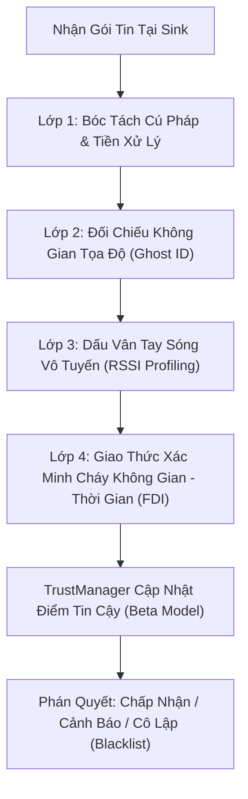

# Tài Liệu Đặc Tả Thuật Toán Phòng Thủ WSN (`defense.py`)

Tài liệu này mô tả chi tiết luồng xử lý của mô-đun phòng thủ `defense.py` theo thứ tự thực thi từ trên xuống dưới, làm rõ cơ sở toán học và logic suy luận của từng lớp bảo vệ.

## 1. Kiến Trúc Tổng Quan
Hệ thống phòng thủ hoạt động theo mô hình đường ống tuần tự (Sequential Pipeline). Mỗi gói tin cảm biến khi đến trạm thu thập dữ liệu (Sink) sẽ đi qua 4 lớp kiểm tra độc lập trước khi được tổng hợp phán quyết tại bộ quản lý điểm tin cậy (**TrustManager**).

---

## 2. Đặc Tả Chi Tiết Các Lớp Phòng Thủ (Defense Layers)

### Lớp 1: Bóc Tách Cú Pháp và Tiền Xử Lý Dữ Liệu
- Giải mã bản tin nhật ký từ Sink thông qua biểu thức chính quy (Regex parsing).
- Trích xuất các trường đặc trưng: `Node ID`, cường độ tín hiệu thu `RSSI (dBm)`, nhiệt độ `Temp (°C)` và nhãn thời gian mô phỏng `sim_time`.
- Phân tách luồng dữ liệu cảm biến ứng dụng khỏi các bản tin điều khiển định tuyến RPL (DIO, DAO, DIS) để đảm bảo tính chính xác của thống kê mạng.

### Lớp 2: Đối Chiếu Không Gian Tọa Độ (Ghost ID Detection & Nhận Diện Kịch Bản Động)
- Hàm `load_topology_map()` tự động phân tích ngữ cảnh từ file log Cooja để nạp sơ đồ tọa độ vật lý tương ứng:
  - Khi phát hiện `Node ID: 54` hoặc chuỗi `BURNING_NODE` $\rightarrow$ Nạp kịch bản `wsn-2sink-distraction.csc` (cụm cháy thực tế tại các Node 30, 31, 32 thuộc Cluster 1).
  - Khi phát hiện `Node ID: 53` $\rightarrow$ Nạp kịch bản `wsn-2sink-hijacked.csc` (15 node hợp lệ từ Node 2 đến Node 16 bị chiếm quyền) hoặc `wsn-2sink-sybil.csc`.
- Khi một gói tin đến, hệ thống đối chiếu `Node ID` với tập hợp các nút hợp lệ trên bản đồ `TopologyMap`:
  - Nếu `Node ID` nằm ngoài danh sách định danh đã đăng ký trên sơ đồ mạng $\rightarrow$ Xác định là định danh giả mạo (**Ghost ID**) do kẻ tấn công Sybil phát sinh.
  - **Cơ chế xử lý:** Đánh dấu `is_fake_id = True` và thực thi **Chặn Tức Thì (Instant Block)** ngay tại Lớp 2:
    - Cập nhật `TrustManager.update_trust(node_id, sybil_passed=False, ...)` với mức phạt nghiêm trọng ($\beta + 100$), đưa điểm tin cậy về `0.98%` và thiết lập `blacklisted = True`.
    - Ghi nhận cảnh báo `GHOST ID DETECTED` lên bảng điều khiển giám sát (Inference Feed) và tăng bộ đếm `spoof_blocked`.
    - Ngừng xử lý gói tin ngay lập tức (`return False`), **không chuyển tiếp xuống Lớp 4** nhằm ngăn chặn việc các định danh giả làm sai lệch trạng thái cửa sổ quan sát nhiệt độ của các nút hợp lệ.

### Lớp 3: Phân Tích Dấu Vân Tay Sóng Vô Tuyến (`SybilDetector`)
**Giai đoạn Học Tĩnh (Learning Phase - 250 gói tin đầu tiên):**
- Hệ thống thu thập giá trị RSSI của từng nút mạng trong điều kiện vận hành bình thường.
- Khi kết thúc 250 gói tin, hệ thống thiết lập ngưỡng cơ sở `Baseline RSSI` (giá trị trung bình cộng) cho mỗi định danh hợp lệ và chuyển sang trạng thái giám sát chủ động (`SYSTEM ARMED`).

**Giai đoạn Giám Sát Chủ Động (Active Monitoring Phase):**
- Phương thức `SybilDetector.check()` tính toán độ lệch tuyệt đối giữa RSSI thực tế của gói tin và `Baseline RSSI` đã lưu trữ:
  $$\Delta \text{RSSI} = |\text{RSSI}_{\text{actual}} - \text{Baseline RSSI}|$$
- **Phát hiện mạo danh vị trí (`RSSI MISMATCH`):** Nếu $\Delta \text{RSSI} > 3.0\text{ dBm}$, gói tin bị đánh dấu bất thường về vị trí phát sóng (`sybil_passed = False`).
- **Khóa vùng phát sóng độc hại (`Zone Blacklisting`):** Nếu một dải cường độ tín hiệu RSSI liên tục phát sinh các định danh giả mạo vượt ngưỡng cho phép (`threshold = 3`), toàn bộ dải băng tần không gian đó ($\pm 2.0\text{ dBm}$) sẽ bị đưa vào danh sách vùng cấm (`Blacklisted Zone`). Mọi gói tin tiếp theo có RSSI nằm trong vùng này đều bị từ chối với mã lỗi `ZONE_BLOCK`.

### Lớp 4: Giao Thức Xác Minh Cháy Không Gian - Thời Gian (Spatio-Temporal Fire Confirmation Protocol)
Lớp kiểm tra này được kích hoạt **vô điều kiện** đối với mọi gói tin từ nút hợp lệ có nhiệt độ báo cáo vượt ngưỡng cháy (`Temp > 60.0°C`), hoạt động độc lập với bộ lọc thống kê phương sai để không bỏ sót các kịch bản tăng nhiệt có chủ đích.

- **Dải Gia Nhiệt Tiền Đám Cháy (Pre-Fire Heating Window: $29.0^\circ\text{C} - 60.0^\circ\text{C}$):**
  - Theo quy luật truyền nhiệt vật lý, một đám cháy thực tế luôn trải qua giai đoạn gia nhiệt tăng dần ($25^\circ\text{C} \rightarrow 35^\circ\text{C} \rightarrow 50^\circ\text{C} \rightarrow 65^\circ\text{C}$).
  - Trong `FDIDetector`, các bản tin nằm trong dải $29.0^\circ\text{C} - 60.0^\circ\text{C}$ được cho phép đi qua để cập nhật trực quan tiến trình tăng nhiệt lên giao diện giám sát và bảng `latest_temps`, đồng thời **không đưa vào cửa sổ tính trung bình trượt $3\sigma$** nhằm bảo toàn ngưỡng nền môi trường ($20^\circ\text{C} - 28^\circ\text{C}$).
- **Tính Minh Bạch Nhiệt Độ Vật Lý (`Physical Temperature Visibility`):**
  - Bảng trạng thái `self.latest_temps[node_id] = temp_c` luôn được cập nhật cho các gói tin hợp lệ, bao gồm cả các nút đang trong trạng thái chờ xác minh (`OBSERVING`).
  - Cơ chế này giải quyết triệt để hiện tượng khóa chéo (Deadlock) khi nhiều nút lân cận cùng bắt đầu cháy lệch pha nhau vài giây: khi nút đầu tiên hoàn tất chu kỳ quan sát, hệ thống đã có sẵn dữ liệu nhiệt độ mới nhất của các nút hàng xóm trong bán kính 15m.
- **Đồng Bộ Thời Gian Mô Phỏng (`Simulation Timestamp Synchronization`):** Hệ thống sử dụng trực tiếp nhãn thời gian mô phỏng (microseconds) từ Cooja thay vì thời gian thực của hệ điều hành, đảm bảo các phép tính khoảng thời gian luôn chính xác tuyệt đối ngay cả khi mô phỏng chạy ở tốc độ cao hoặc khi đọc lại file log.

**1. Kiểm Tra Bất Thường Vật Lý Tức Thời (Immediate Anomaly Check)**
Trước khi mở cửa sổ quan sát, nếu gói tin vi phạm các ràng buộc vật lý cơ bản dưới đây, hệ thống sẽ kết luận tấn công chiếm quyền (**HIJACK**) và **Chặn Tức Thì (Instant Block)**:
- **Bất thường khoảng cách không gian (`Teleporting Fire`):** Hai nút cách nhau $> 35\text{m}$ (thuộc hai cụm khác nhau) đồng thời báo nhiệt độ $> 60^\circ\text{C}$ trong khoảng thời gian chênh lệch $< 5.0\text{s}$ $\rightarrow$ Vi phạm tốc độ lan truyền nhiệt vật lý $\rightarrow$ **HIJACK DETECTED: Teleporting Fire**.
- **Bất thường đồng bộ thời gian (`Sync Burst`):** Có từ $\ge 5$ nút trong bán kính $15\text{m}$ đồng loạt tăng vọt lên $> 60^\circ\text{C}$ trong vòng $< 5.0\text{s}$ mà không có độ trễ lan truyền $\rightarrow$ **HIJACK DETECTED: Sync Burst**.
- **Đứt gãy gradient nhiệt độ (`Temp Cliff`):** Tâm cụm ($\le 15\text{m}$) có $\ge 5$ nút báo nhiệt độ cực cao nhưng vành đai lân cận ($15\text{m} - 25\text{m}$) lại có $\ge 2$ nút giữ nhiệt độ môi trường bình thường ($< 40^\circ\text{C}$) $\rightarrow$ **HIJACK DETECTED: Temp Cliff**.

**2. Tạm Hoãn Phán Quyết & Đóng Băng Điểm Tin Cậy (`Observation Window = 10.0s`)**
- Khi nút báo nhiệt độ $> 60^\circ\text{C}$ lần đầu tiên, hệ thống ghi nhận thời điểm `fire_timestamps[node_id]`.
- Cửa sổ quan sát được thiết lập ở mức **10.0 giây**:
  - Chu kỳ phát tin khi có sự kiện nhiệt độ cao là $3\text{ giây/gói}$; các nút trong đám cháy thực tế có độ trễ lan truyền nhiệt theo khoảng cách ($0\text{s}, 6\text{s}, 12\text{s}$).
  - Khoảng thời gian $10.0\text{s}$ tương đương 3–4 chu kỳ phát tin, đảm bảo các gói tin từ nút láng giềng có đủ thời gian vượt qua lịch truyền **TSCH (IEEE 802.15.4e)** và định tuyến đa bước nhảy **RPL** để về tới Sink.
- Khi `elapsed < 10.0s`: Nút được gán trạng thái 🔍 **OBSERVING**.
- **Đóng băng điểm tin cậy:** Trong suốt thời gian `OBSERVING`, `TrustManager` giữ nguyên điểm số hiện tại của nút (không cộng điểm thưởng $\alpha$, không trừ điểm phạt $\beta$), ngăn chặn kẻ tấn công lợi dụng thời gian chờ để tích lũy điểm uy tín giả tạo.

**3. Kết Thúc Cửa Sổ Quan Sát & Phán Quyết Tương Quan Cụm (`elapsed >= 10.0s`)**
Khi thời gian quan sát đạt từ $10.0\text{ giây}$ trở lên, hệ thống đánh giá sự đồng thuận không gian trong bán kính $15\text{m}$:

- **Loại Trừ Nhân Chứng Đã Bị Cô Lập (`Blacklist Witness Exclusion`):**
  - Khi quét danh sách các nút láng giềng có nhiệt độ cao (`hot_neighbors` trong bán kính $15\text{m}$), mọi nút đã nằm trong danh sách đen (`is_blacklisted(nid) == True`) đều bị loại khỏi tập nhân chứng. Các nút đã bị xác định là độc hại không có tư cách xác thực chéo cho nút khác.

- **Nhận Diện Làn Sóng Tấn Công & Chống Thông Đồng (`Attack Wave Awareness & Collusion Detection`):**
  - Trong kịch bản nhiều nút bị chiếm quyền nằm gần nhau ($< 15\text{m}$), các nút độc hại có thể phát dữ liệu giả cùng lúc để tự xác thực chéo cho nhau (**Mutual Vouching**).
  - **Cơ chế phòng thủ thích ứng:**
    1. Hệ thống thống kê số lượng nút bị cô lập do hành vi `HIJACK` trong vòng $120\text{ giây}$ gần nhất (`recent_hijack_blocks`).
    2. Nếu `recent_hijack_blocks >= 3` $\rightarrow$ Hệ thống xác định mạng đang chịu một làn sóng tấn công phối hợp (**Active Attack Wave**).
    3. Trong trạng thái này, điều kiện để xác nhận cháy thật đòi hỏi phải có ít nhất một nút láng giềng đóng vai trò **nhân chứng độc lập** (`fire_warning_count == 0`, chưa từng nằm trong diện nghi vấn).
    4. Nếu toàn bộ các nút láng giềng báo nóng đều là các nút đang bị theo dõi nghi vấn $\rightarrow$ Kết luận hành vi thông đồng (**COLLUSION DETECTED: Mutual Vouching**) và thực thi **Chặn Tức Thì (Instant Block)**.
  - **Tính độc lập với kịch bản Nghi binh (`Distraction`):** Trong kịch bản cháy thật kết hợp nghi binh, nút tấn công chỉ bị chặn ở Lớp 2/Lớp 3 với mã `SYBIL_CLONE` / `ZONE_BLOCK` (`recent_hijack_blocks` luôn bằng `0`). Nhờ đó, cụm nút cháy thật (Node 30, 31, 32) vẫn xác thực chéo cho nhau bình thường mà không bị ảnh hưởng.

- **Xác Nhận Cháy Thật (`True Fire Confirmed`):**
  - Nếu có từ $\ge 1$ nút láng giềng hợp lệ trong bán kính $15\text{m}$ cùng ghi nhận nhiệt độ $\ge 55.0^\circ\text{C}$ và thỏa mãn điều kiện nhân chứng $\rightarrow$ Phán quyết **TRUE FIRE CONFIRMED**, duy trì 100% điểm tin cậy và kích hoạt cảnh báo cháy khẩn cấp trên giao diện.

- **Báo Động Giả Đơn Độc (`Lone Node False Alarm`):**
  - Nếu sau $10.0\text{ giây}$ quan sát, nút vẫn đứng đơn độc báo nhiệt độ $> 60^\circ\text{C}$ trong khi không có bất kỳ nút láng giềng nào trong bán kính $15\text{m}$ ghi nhận nhiệt độ tăng cao $\rightarrow$ Phán quyết **HIJACK DETECTED: Lone Node Anomaly** và thực thi **Chặn Tức Thì (Instant Block)**.

---

## 3. Mô Hình Quản Lý Điểm Tin Cậy (`TrustManager`)
Hệ thống quản lý độ tin cậy của từng nút dựa trên mô hình phân phối Beta (**Beta Reputation System**) với hai tham số tích lũy $\alpha$ (hành vi hợp lệ) và $\beta$ (hành vi vi phạm):

$$\text{Trust Score} = \frac{\alpha}{\alpha + \beta} \times 100\%$$

- **Khởi tạo:** $\alpha = 10.0, \beta = 1.0$ (tương ứng điểm tin cậy ban đầu `90.9%`). Ngưỡng cách ly: nếu `Trust Score < 40.0%` $\rightarrow$ Đưa vào danh sách đen (**BLACKLIST** - cô lập vĩnh viễn khỏi mạng).
- **Cập nhật khi gói tin hợp lệ:** Nếu vượt qua cả kiểm tra định danh (Sybil) và kiểm tra dữ liệu (FDI) $\rightarrow$ Tăng điểm thưởng $\alpha \leftarrow \alpha + 1.0$.
- **Phạt Điểm Nghiêm Trọng (`Hard Penalty / Instant Block`):**
  - Áp dụng cho `attack_type == "HIJACK"` (báo động giả FDI, thông đồng bảo lãnh chéo, bất thường không gian - thời gian) và `attack_type in ["ZONE_BLOCK", "SYBIL_CLONE"]` (định danh giả Ghost ID, vi phạm vùng cấm RSSI).
  - Thiết lập $\alpha = 1.0$ và cộng phạt $\beta \leftarrow \beta + 100.0$, hạ điểm tin cậy xuống `~0.98%` và cô lập nút ngay lập tức.
- **Phạt Điểm Lũy Tiến (`Soft Penalty`):**
  - Sai lệch cường độ tín hiệu nhẹ (`RSSI MISMATCH`): Cộng phạt $\beta \leftarrow \beta + 4.0$ (tránh cô lập nhầm các nút hợp lệ khi kênh truyền vô tuyến suy hao tạm thời).
  - Nhiễu dữ liệu thống kê ở nhiệt độ thường: Cộng phạt $\beta \leftarrow \beta + 2.0$.

---

## 4. Cơ Chế Hiển Thị Trực Quan Thời Gian Thực (`Dashboard Real-time Visibility`)
- **Cập nhật trạng thái vật lý liên tục:** Tại `monitor_server.py`, giá trị nhiệt độ thực tế (`temp_c`) và thời điểm nhận tin (`last_seen`) của từng nút luôn được cập nhật vào cấu trúc `network_data['nodes'][node_id]` ngay khi gói tin đến Sink, trước khi quyết định lọc gói tin được thực thi.
- **Phân tách rõ ràng trên giao diện giám sát:**
  - **Nút hợp lệ / Cháy thật:** Hiển thị trạng thái `Alive`, thông số nhiệt độ chuyển màu đỏ cảnh báo và kích hoạt biểu ngữ khẩn cấp `CRITICAL TEMPERATURE ALERT`.
  - **Nút bị cô lập (`Hijacked / Lone Node / Ghost ID`):** Hiển thị nhãn trạng thái `BLOCKED` kèm đường gạch ngang, giữ lại giá trị nhiệt độ giả mạo cuối cùng (ví dụ `85.0°C`) để phục vụ quan sát trực quan, đồng thời loại bỏ hoàn toàn nút đó khỏi các phép tính thống kê hiệu năng mạng (PDR, năng lượng trung bình, độ trễ).
